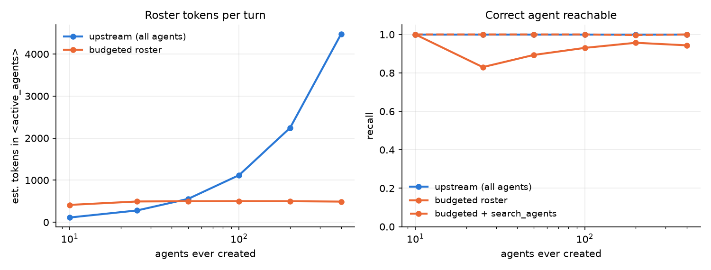
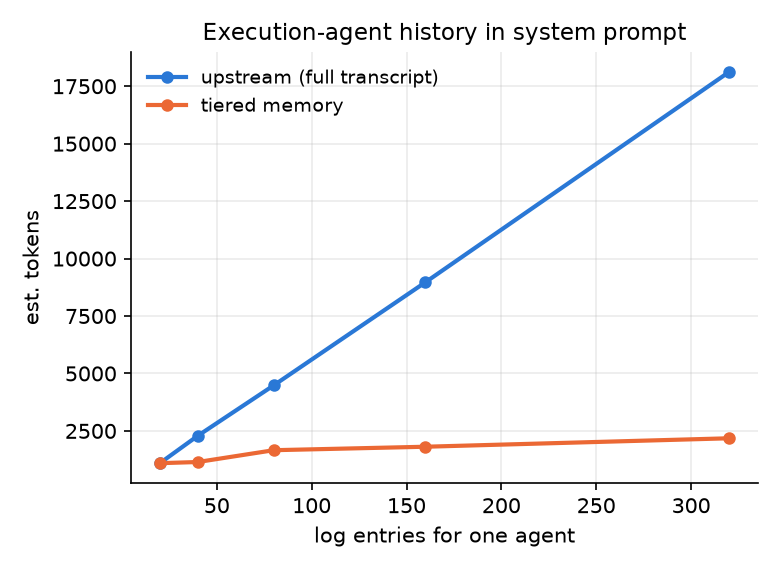

# OpenPoke — agent overload, fixed and measured

Fork of [shlokkhemani/openpoke](https://github.com/shlokkhemani/openpoke) (an open-source
reconstruction of Poke's multi-agent architecture; see the
[explainer](https://www.shloked.com/writing/openpoke)). Upstream setup instructions are in
[README.upstream.md](README.upstream.md).

The author names **execution-agent overload** as the system's main open problem: every
request passes the full roster of agents to the Interaction Agent, and after days of use
hundreds compete for attention. This fork treats that as *two* coupled problems, fixes both,
adds the cheap wins around them, and ships the tests and evaluators to show what changed.

## Results at a glance

All numbers from `python -m evals.run_all` (offline, deterministic, no API key needed).

| What | Upstream | This fork |
|---|---|---|
| Roster tokens per turn, 400 agents | 4,476 and growing linearly | **491, flat** (12 entries) |
| Correct agent reachable, 400 agents | 100% (everything is in the prompt) | 94% in roster, **100% with `search_agents`** |
| Execution-agent history in prompt, 320 log entries | 18k tokens, unbounded | **2.2k tokens** (12%) |
| Reminder commitments surviving compaction | n/a (nothing is compacted) | **100%** |
| Email classifier model calls | every email | **50% fewer**, zero important emails dropped |
| Modelled cost, 200 agents, 40 turns/day | $6.71/day | **$2.87/day (−57%)** |




Every roster "miss" on the left chart is an agent idle for >14 days (archived by design);
retrieval among live agents is 100% at every population size, and the `search_agents`
fallback recovers the archived ones.

## The problem, located in code

Read-through notes with line references: [ARCHITECTURE.md](ARCHITECTURE.md). The short version:

1. **Horizontal overload** — `services/execution/roster.py` is a JSON list of agent *names*.
   `_render_active_agents()` emits all of them, every turn, with no description, recency or
   pruning. Cost is O(#agents) per turn and reuse decisions degrade as names collide.
2. **Vertical overload** — `ExecutionAgent.build_system_prompt_with_history()` embeds the
   agent's **entire** append-only log (raw tool payloads included) in the system prompt.
   The main conversation is summarised; execution agents never are. This turns out to be the
   single largest cost line, not the roster.
3. Everything runs on the strong model, including email classification on every inbound mail.
4. Triggers wake agents *by name*, so any pruning scheme that forgets an agent orphans its reminders.
5. There were no tests.

## What I built

### 1. `AgentRegistry` — budgeted roster (`server/services/execution/registry.py`)

Replaces the flat roster with per-agent metadata (created/last-used, use count, first
instruction, rolling one-line summary) and a per-turn selection:

- **Lifecycle**: idle > 48h → *dormant*; idle > 14d → *archived* (out of the prompt, still searchable).
  Agents that own a pending trigger are **pinned** and never archived; a firing trigger `touch()`es
  its agent back to active. This closes the orphaned-reminder gap.
- **Hot cache**: the 4 most recently used agents are always shown, because follow-ups
  ("did she reply?", "ok send it") carry no retrievable keywords.
- **Retrieval**: BM25 + token-overlap over name/description/summary/recent requests, blended with a
  recency prior (half-life 3 days) so "any update on the visa?" resolves to the visa agent you
  most recently worked with, not the oldest one.
- **Budget**: at most 12 entries, each rendered with status, last-used and summary, followed by a
  `<roster_note>` saying how many are hidden.
- **`search_agents` tool** for the Interaction Agent: the AnyTool-style self-correction step.
  The system prompt tells it to search before spawning a new agent for a person/thread/topic.

`OPENPOKE_ROSTER_STRATEGY=all` reproduces upstream byte-for-byte; the legacy `roster.json` is
migrated and kept in sync.

*Why BM25 and not embeddings?* Agent descriptions are short and name-heavy; lexical overlap on
a person's name is the dominant signal and it needs no network, no model and no index service.
Tool-retrieval benchmarks (ToolRet) show general-purpose dense retrievers underperform on this
kind of corpus anyway. Embeddings are a drop-in upgrade to `AgentRegistry.search()` if a
workload shows paraphrase misses; hybrid (BM25 + dense, RRF-fused) is the standard next step.

### 2. `AgentMemory` — tiered per-agent memory (`server/services/execution/memory.py`)

The MemGPT/Mem0 shape, scoped to one agent:

```
# Memory (compressed)
## Facts            key → value, with temporal invalidation (old value kept as "changed")
## Open threads     what we're waiting on
## Timeline         one-line dated episodes
# Recent History    last 12 log entries, verbatim
```

Compaction runs after an agent finishes a task if its raw log exceeds a 12k-char budget, and
only absorbs entries older than the raw tail, so it is incremental. The extractor is a single
cheap-model call with a strict JSON contract (`LLMExtractor`); a deterministic
`HeuristicExtractor` is the fallback and powers the offline evals. Each compaction pushes a
one-line summary into the registry, so the roster shows *what an agent is doing*, not just its name.

*On the knowledge-graph idea.* Zep/Graphiti's temporal fact invalidation is the part worth
stealing and it's here (`Fact.invalidated_at` / `superseded_by`). A full entity graph is not:
per-agent memory is one entity's event stream, Mem0's own ablation shows graph memory adds ~2
points over structured facts, and LLM relation extraction is the cost we're trying to cut.
Cross-agent linking (Alice *and* Bob are on the lunch thread) is where a graph would start to pay.

### 3. Model router + usage ledger (`server/services/llm/`)

All five LLM call sites now go through `complete(role=...)`. Roles map to a strong or cheap tier
(user-facing interaction and execution stay strong; email classification, summarisation, email
search and memory compaction go cheap), overridable per role via env. Every call is recorded with
tokens and estimated cost; `GET /meta/usage` exposes totals by role and model, `GET /meta/agents`
exposes registry lifecycle state. `OPENPOKE_ROUTING=strong_only` reproduces upstream.

### 4. Email pre-filter (`server/services/gmail/prefilter.py`)

A conservative rule layer runs before the LLM importance classifier: anything with a
could-matter signal (OTP, security, calendar, replies, payments, "action required") always goes
to the model; obvious bulk (promotions/social labels with unsubscribe footers, bulk senders,
spam) is dismissed. 40 labelled emails in `tests/fixtures/emails.json` pin the property that no
important email is ever dismissed, and double as a live precision/recall set for the full pipeline.

## Tests and evaluators

```bash
python -m venv .venv && . .venv/bin/activate
pip install -r server/requirements.txt pytest pytest-asyncio matplotlib

python -m pytest                 # 53 tests, < 1s, no network
python -m evals.run_all          # all offline evals -> evals/out/*.json + charts
```

| Suite | What it checks |
|---|---|
| `tests/test_registry.py` | lifecycle transitions, trigger pinning, trigger touch re-activation, budget cap, hot cache without keywords, retrieval of a buried agent, same-name disambiguation, archived-but-searchable, upstream-identical rendering in `all` mode |
| `tests/test_memory.py` | upstream-identical before first compaction, prompt bound + verbatim tail, incremental compaction, fact supersession with history, thread open/update/resolve, **reminder commitment survives compaction**, LLM extractor JSON parsing + fallback |
| `tests/test_router_and_gateway.py` | tiering, per-role overrides, env parsing, usage recorded from provider or estimated |
| `tests/test_email_prefilter.py` | parametrised: every important fixture reaches the model; ≥60% of noise caught |
| `tests/test_interaction_e2e.py` | the real `InteractionAgentRuntime` loop with a scripted LLM: bounded roster with note at 60 agents, `search_agents` finds the hidden agent, delegation touches the registry |

| Evaluator | Measures | Needs key |
|---|---|---|
| `evals.roster_eval` | roster tokens/turn and recall of the correct agent across 10–400 agents, upstream vs budgeted, by query flavour (keyword / name-only / topic-only / keyword-free) | no |
| `evals.memory_eval` | prompt size and needle retention (surface facts, facts buried in tool payloads, reminder commitments) across 20–320 log entries | no (`--live` for the LLM extractor) |
| `evals.email_eval` | pre-filter skip rate and skip precision | no (`--live` for pipeline P/R/F1) |
| `evals.cost_eval` | $/user/day under upstream / routing-only / context-only / both, from measured token savings and a printed call-mix assumption | no |
| `evals.live_routing_eval` | the **real Interaction model** choosing an agent from the real prompt: accuracy, new-agent spawns, prompt tokens, $ — upstream vs budgeted + `search_agents` | yes |

The synthetic workload (`evals/synthetic.py`) is seeded and deliberately adversarial: the same
person recurs across topics, the same topic across people, agent names come from the five name
patterns the Interaction Agent actually uses, and queries include ones with no retrievable
words at all.

### How I'd read the eval numbers

- The roster fix trades a bounded amount of recall (archived agents only) for a constant
  prompt. The fallback tool makes it recoverable rather than lost, at the price of one extra
  tool round-trip on the rare miss.
- The memory eval is honest about the heuristic extractor: it keeps surface facts and
  commitments but loses facts that only ever appeared inside raw tool payloads. That is
  exactly why the runtime default is the LLM extractor; `--live` measures it.
- The cost model's assumptions are editable in `evals/cost_eval.py` and printed with the
  result. The takeaway that survives any reasonable assumption: **per-agent history is the
  biggest line item**, bigger than the roster the explainer focuses on.

## Running the server

As upstream (`README.upstream.md`). New knobs are documented in `.env.example`; defaults turn
everything on. Set `OPENPOKE_ROSTER_STRATEGY=all`, `OPENPOKE_AGENT_MEMORY=0` and
`OPENPOKE_ROUTING=strong_only` to get upstream behaviour for A/B comparison on a real inbox.

## Gaps I saw beyond the brief

Fixed in this fork:
- **Orphaned reminders** — pruning agents without pinning trigger owners would silently break
  reminders. Registry pins agents with active triggers; trigger fires re-activate them.
- **No per-agent memory** — see above; it dominates cost.
- **Classifier on every email** — pre-filter.
- **Zero tests** — 53 now, plus five evaluators.

Flagged, not built (what I'd do next, in order):
1. **Duplicate-agent consolidation.** The Interaction Agent still *can* create "Email to Alice"
   next to "Alice Lunch". The registry now surfaces both with summaries so the model can pick,
   and the eval defines the target as the most recent of the pair, but a merge step (same
   person+topic, union of memory) would remove the ambiguity at the source.
2. **Hybrid retrieval.** Add a small embedding index alongside BM25 (RRF fusion) and re-run
   `roster_eval` with paraphrased queries to see if it earns its cost.
3. **Trigger-aware budgets.** Reminder wake-ups could run on the cheap tier when the payload is
   a plain notification; today role = execution = strong.
4. **Cross-agent facts.** When two agents share an entity, link their fact stores — the point at
   which a graph starts paying for itself.
5. **Live A/B on a real inbox** with `/meta/usage` before/after; the offline numbers are a model.

## Files changed

```
ARCHITECTURE.md                                   code-path notes with line refs
server/services/execution/registry.py             AgentRegistry (new)
server/services/execution/memory.py               AgentMemory (new)
server/services/llm/{router,usage,gateway}.py     routing + ledger (new)
server/services/gmail/prefilter.py                email pre-filter (new)
server/agents/interaction_agent/{agent,tools}.py  budgeted roster, search_agents tool
server/agents/interaction_agent/system_prompt.md  search_agents guidance
server/agents/execution_agent/{agent,runtime}.py  memory-backed history, compaction hook
server/services/trigger_scheduler.py              touch agent on fire
server/services/gmail/importance_watcher.py       prefilter before classify
server/routes/meta.py                             /meta/usage, /meta/agents
tests/                                            53 tests + labelled email fixtures
evals/                                            5 evaluators + synthetic workload
```
